# DOKUMENTASI ARSITEKTUR SISTEM SIPETA
## Sistem Informasi Pelayanan Terpadu — Pondok Pesantren Modern Abu Manshur

---

## 1. RINGKASAN EKSEKUTIF

SIPETA (*Sistem Informasi Pelayanan Terpadu*) adalah platform tata kelola terintegrasi berbasis web dan *mobile-responsive* yang dirancang khusus untuk Pondok Pesantren Modern Abu Manshur (Plered, Cirebon). Platform ini menghubungkan lima pemangku kepentingan utama: Pimpinan Pesantren (Superadmin), Bagian Administrasi (Admin), Bagian Keuangan (Bendahara), Bidang Kepengasuhan & Asrama (Pengelola), serta Orang Tua/Wali Santri (Wali).

Sistem dibangun di atas fondasi teknologi modern:
- **Frontend & App Server**: Next.js 15 (App Router), React 19, TypeScript strict mode, Tailwind CSS.
- **Backend & Database**: Supabase Managed PostgreSQL 15+, Row Level Security (RLS), Supabase Storage.
- **Autentikasi**: Supabase Auth dengan pemetaan identitas berbasis username internal dan NIS santri.
- **Infrastruktur Deployment**: Vercel Serverless Edge Runtime terintegrasi CI/CD GitHub.

---

## 2. DIAGRAM ARSITEKTUR SISTEM

```mermaid
graph TD
    subgraph ClientLayer ["1. CLIENT LAYER (Responsive Web & Mobile)"]
        U_Wali["Wali Santri (Mobile View / Portal Wali)"]
        U_Bendahara["Bendahara Pesantren (Verifikasi & Ledger)"]
        U_Admin["Admin Administrasi (Santri, Excel, Rekening)"]
        U_Pengelola["Pengelola Asrama (Tahfidz & Disiplin)"]
        U_Superadmin["Superadmin (Tata Kelola Pengguna & Audit)"]
    end

    subgraph AppServerLayer ["2. APPLICATION SERVER (Next.js 15 on Vercel)"]
        AppRouter["App Router (/ & Layouts)"]
        AuthMiddleware["Server Auth Middleware (@supabase/ssr)"]
        
        subgraph RouteHandlers ["API Route Handlers"]
            ApiHealth["/api/health (Database & Schema Check)"]
            ApiAdminUsers["/api/admin-users (Superadmin User Provisioning)"]
            ApiAdminSantri["/api/admin-santri (Santri Management)"]
            ApiImport["/api/admin-santri/import (Excel Import & Auto Wali)"]
            ApiChangePwd["/api/auth/change-password (Wajib Ganti Password)"]
            ApiSignedUrl["/api/signed-url (15-Min Private Storage Token)"]
        end
        
        ContextLayer["SipetaContext (Dual Mode: Live Supabase / Standalone Demo)"]
    end

    subgraph DatabaseLayer ["3. DATABASE & STORAGE LAYER (Supabase Managed PostgreSQL)"]
        PostgreSQL["PostgreSQL 15+"]
        
        subgraph CoreSchemas ["Skema & Tabel Utama (27 Tabel)"]
            T_Profiles["public.profiles (Role, Username, MustChangePwd)"]
            T_Santri["public.santri (NIS, Kelas, Kamar, Soft Delete)"]
            T_Wali["public.wali_santri (Relasi 1:1 Unik)"]
            T_Keuangan["public.tagihan & public.transaksi_pembayaran"]
            T_Ledger["public.saldo_uang_saku & public.mutasi_uang_saku"]
            T_Akademik["public.setoran_tahfidz & public.pelanggaran_disiplin"]
            T_Audit["public.audit_logs (Immutable Trigger Enforced)"]
            T_Rekening["public.rekening_pesantren (1 Rekening BSI Aktif)"]
        end
        
        subgraph SecurityEngine ["Security & Enforcement Engine"]
            RLS["49 Row Level Security Policies"]
            Triggers["PostgreSQL Immutability & Ledger Triggers"]
            AdminAuth["Supabase Auth (Admin API & Cookies Session)"]
        end
        
        subgraph StorageBuckets ["Private Storage (public = false)"]
            B_BuktiBayar["bukti-pembayaran"]
            B_UangSaku["foto-penyerahan-saku & bukti-uang-saku"]
        end
    end

    %% Relasi Alur
    ClientLayer --> AppRouter
    AppRouter --> ContextLayer
    ContextLayer --> RouteHandlers
    RouteHandlers --> AuthMiddleware
    AuthMiddleware --> SecurityEngine
    SecurityEngine --> CoreSchemas
    RouteHandlers --> StorageBuckets
    SecurityEngine --> PostgreSQL
```

---

## 3. LAPISAN ARSITEKTUR UTAMA

### A. Lapisan Frontend & State Management
1. **Next.js 15 App Router**:
   - `src/app/page.tsx`: Gerbang publik terpadu. Menampilkan informasi pesantren, form login resmi berbasis username, modal wajib ganti password untuk wali baru, serta merender portal kerja sesuai role pengguna terautentikasi.
   - Menggunakan dynamic code splitting dan Server Components untuk memastikan First Load JS optimal (~103 kB).
2. **Context Terpadu (`SipetaContext`)**:
   - Terletak pada [`src/lib/store/sipeta-context.tsx`](file:///C:/Users/Eko/.gemini/antigravity/scratch/sipeta/src/lib/store/sipeta-context.tsx).
   - Mengelola status sesi, data master, keranjang cicilan, notifikasi, dan status konektivitas.
   - Mengimplementasikan pola **Dual Mode**:
     - `authMode: "supabase"`: Mengalirkan mutasi secara langsung ke PostgreSQL Supabase, lalu menyinkronkan data kembali dengan `refreshFromSupabase()`.
     - `authMode: "demo"`: Beroperasi secara mandiri (*standalone*) dalam memori browser ketika kredensial Supabase belum dihubungkan, tanpa mengganggu data produksi.

### B. Lapisan Autentikasi & Pemetaan Username
1. **Kebijakan Non-Gmail untuk Akun Internal**:
   - Seluruh petugas internal (Admin, Bendahara, Pengelola) masuk menggunakan **username** pilihan (contoh: `admin01`, `bendahara01`).
   - Wali Santri masuk menggunakan **NIS Santri** sebagai username dan password awal.
   - Pimpinan tertinggi (Superadmin) masuk menggunakan email resmi: `sipetaabumanshur@gmail.com`.
2. **Pemetaan Email Sintetis di Backend**:
   - Supabase Auth membutuhkan identitas email untuk autentikasi password.
   - Backend memetakan username ke domain privat reserved:
     $$\text{Email Auth} = \text{username} + \text{"@akun.sipeta.invalid"}$$
   - Domain sintetis ini **tidak pernah ditampilkan** pada antarmuka pengguna, tabel, kartu, atau modal.
3. **Mekanisme Wajib Ganti Password Pertama Kali**:
   - Akun wali santri yang dibuat otomatis dari NIS santri diberi tanda `must_change_password = true`.
   - Pada saat login pertama kali, sistem mencegat sesi dan menampilkan modal wajib ganti sandi.
   - Password baru wajib berbeda dengan NIS. Setelah berhasil diperbarui, penanda diubah menjadi `false`.

### C. Lapisan Backend & API Route Handlers
1. `/api/health`: Memeriksa kesehatan database dengan latensi aktual dan mendiagnosis secara presisi apakah database tidak terhubung, skema belum dibuat (`TABLES_MISSING`), skema siap namun data kosong (`SCHEMA_READY_EMPTY`), atau operasional sehat (`SCHEMA_READY_WITH_DATA`).
2. `/api/admin-users`: Endpoint server eksklusif Superadmin untuk membuat, mengelola, mengubah password, dan menonaktifkan akun. Menggunakan `createSupabaseAdminClient()` (Service Role) dengan mekanisme **kompensasi atomik** jika penyimpanan profil gagal.
3. `/api/admin-santri`: Endpoint server untuk mutasi data santri oleh Admin Administrasi.
4. `/api/admin-santri/import`: Pemrosesan impor massal santri dari Excel dengan pembacaan NIS format teks (menjaga angka nol di depan), validasi kelas/kamar, pembuatan akun wali otomatis, serta audit kompensasi kegagalan.
5. `/api/auth/change-password`: Endpoint penggantian kata sandi aman bagi pengguna yang telah masuk.
6. `/api/signed-url`: Generator URL bertanda tangan aman dengan masa berlaku 15 menit untuk mengunduh bukti transfer dan foto penyerahan uang saku dari bucket penyimpanan privat.

### D. Lapisan Database & Keamanan (PostgreSQL)
1. **Row Level Security (RLS)**:
   - 27 tabel publik dilindungi oleh 49 kebijakan RLS.
   - Akses anonim ditutup total dari seluruh data keuangan (`rekening_pesantren`, `tagihan`, `transaksi_pembayaran`, `mutasi_uang_saku`).
2. **Ledger Uang Saku Append-Only**:
   - Mutasi uang saku santri tidak dapat diubah atau dihapus sembarangan.
   - Setiap mutasi `KELUAR` (penyerahan uang saku ke santri) wajib menyertakan bukti foto fisik penyerahan.
3. **Integritas Audit Log**:
   - Tabel `public.audit_logs` dilindungi oleh trigger `trg_protect_audit_logs_immutability` yang menolak perintah `UPDATE` dan `DELETE`.
   - Password pengguna tidak pernah disimpan dalam audit log.
4. **Proteksi Rekening Resmi Tunggal**:
   - Indeks parsial unik `idx_single_active_rekening_pesantren` menjamin hanya satu rekening bank resmi (BSI) yang aktif di pesantren pada satu waktu.

