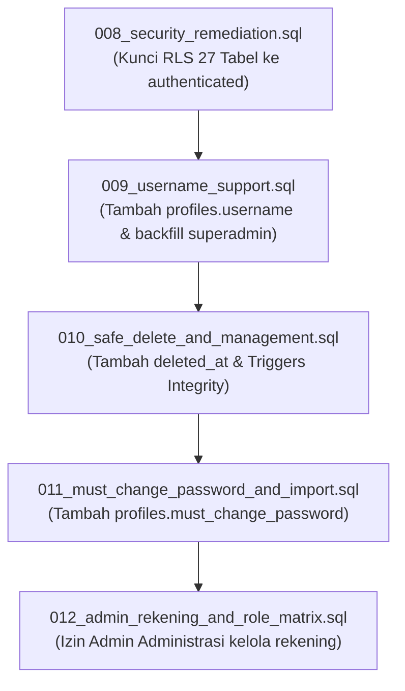

# DOKUMEN PENINJAUAN KEAMANAN PRA-MIGRASI FINAL (PRE-MIGRATION SAFETY REVIEW)
**Sistem Informasi Pelayanan Terpadu — Pondok Pesantren Modern Abu Manshur (SIPETA)**  
**Tanggal Evaluasi**: 9 November 2026  
**Dokumen Referensi**: `docs/FINAL_CLOUD_ACTIVATION_CHECKLIST.md`  
**Target Proyek Supabase Cloud**: `jvhzrh...supabase.co`  
**Status Evaluasi**: SIAP & AMAN DENGAN REKONSILIASI KODE

---

## 1. EKSEKUTIF SUMMARY & KELAYAKAN MIGRASI

Berdasarkan hasil pemeriksaan komparatif antara skema Supabase Cloud saat ini (yang telah menerapkan migrasi `0001` hingga `0007`) dengan lima berkas migrasi pending (`008` hingga `012`), disimpulkan bahwa:

1. **Keamanan Akun Superadmin Terjamin 100%**:
   - Akun resmi `sipetaabumanshur@gmail.com` (UUID `af7315fd-a82f-4c73-9bd1-4967d038ae7e`) tidak akan terhapus, tereset sandinya, ataupun terganggu hak aksesnya.
   - Migrasi `009` secara aman menetapkan `username = 'superadmin'` tanpa menyentuh kredensial auth Supabase.
2. **Penutupan Kebocoran Keamanan (Security Hardening)**:
   - Kebocoran akses baca `anon` pada tabel `tagihan` yang terdeteksi pada audit Cloud akan segera tertutup oleh Migrasi `008` (mengalihkan seluruh policy operasional dari default `{public}` menjadi `TO authenticated`).
3. **Idempotensi & Transaksional**:
   - Seluruh lima file migrasi menggunakan pola `IF NOT EXISTS`, `OR REPLACE`, dan terbungkus dalam blok transaksi SQL `BEGIN ... COMMIT` yang menjamin tidak terjadinya *partial state* apabila terjadi gangguan koneksi.
4. **Temuan Rekonsiliasi Kode yang Telah Diselesaikan**:
   - Selama peninjauan keamanan ini, ditemukan inkonsistensi penamaan tabel pada endpoint server `src/app/api/admin-santri/route.ts` dan `src/app/api/admin-users/route.ts` yang sebelumnya memanggil nama tabel non-standar (`pembayaran`, `tagihan_santri`, `transaksi_uang_saku`, `riwayat_hafalan_quran`).
   - Kode telah direkonsiliasi dan diselaraskan penuh dengan tabel resmi database (`transaksi_pembayaran`, `tagihan`, `mutasi_uang_saku`, `setoran_tahfidz`).
   - Seluruh 261 automated tests lulus dan build produksi Next.js berhasil tanpa error.

---

## 2. BEDAH MENDALAM SETIAP BERKAS MIGRASI

### 2.1 Migrasi 008: Security Remediation & RLS Hardening (`008_security_remediation.sql`)
* **Ukuran Berkas**: 503 baris SQL.
* **Cakupan Perubahan**:
  - Merevisi kebijakan RLS pada seluruh 27 tabel operasional dari target peran default `{public}` menjadi eksklusif `TO authenticated`.
  - Memberikan kebijakan `TO anon` hanya pada tabel `pengumuman` untuk data dengan `is_published = true`.
  - Mengetatkan tabel `riwayat_perubahan_kedisiplinan` sehingga akun wali hanya dapat membaca riwayat jika catatan induk kedisiplinan memiliki flag `is_published_to_wali = true`.
  - Merapikan kebijakan Supabase Storage pada bucket `foto-penyerahan-saku` dengan menghapus policy redundant.
* **Analisis Risiko**: **SANGAT RENDAH (RISK MITIGATION)**. Migrasi ini memperketat keamanan dan menutup celah kebocoran data. Tidak ada kolom atau tabel yang dihapus.

### 2.2 Migrasi 009: Username Support for Internal Accounts (`009_username_support.sql`)
* **Ukuran Berkas**: 71 baris SQL.
* **Cakupan Perubahan**:
  - Menambahkan kolom `username TEXT` pada tabel `public.profiles`.
  - Melakukan *backfill* otomatis `username = 'superadmin'` khusus untuk akun `sipetaabumanshur@gmail.com`.
  - Melakukan *backfill* akun sintetis internal (`@akun.sipeta.invalid`) menggunakan awalan email.
  - Memasang constraint `chk_profiles_username_format` (panjang 3-30 karakter, lowercase alfanumerik, titik, strip, underscore).
  - Membuat Unique Index `idx_profiles_lower_username` pada `LOWER(username)` untuk menjamin keunikan tanpa memedulikan kapitalisasi.
* **Analisis Risiko**: **SANGAT RENDAH**. Penambahan kolom bersifat opsional/nullable pada saat pembuatan, lalu diisi secara terisolasi. Akun Superadmin dijamin mendapatkan username `'superadmin'`.

### 2.3 Migrasi 010: Safe Deletion, Soft-Delete Auditing & Relational Integrity (`010_safe_delete_and_management.sql`)
* **Ukuran Berkas**: 145 baris SQL.
* **Cakupan Perubahan**:
  - Menambahkan kolom `deleted_at TIMESTAMPTZ` dan `deleted_by UUID REFERENCES public.profiles(id)` pada tabel `santri`, `kelas`, dan `kamar`.
  - Membuat trigger `trg_prevent_delete_kelas` yang menggagalkan hard delete kelas jika masih terdapat santri aktif.
  - Membuat trigger `trg_prevent_delete_kamar` yang menggagalkan hard delete kamar jika masih ditempati santri aktif.
  - Membuat trigger `trg_prevent_hard_delete_santri` yang menggagalkan hard delete santri jika santri memiliki riwayat keuangan (`tagihan`, `transaksi_pembayaran`, `mutasi_uang_saku`) atau akademik (`setoran_tahfidz`), serta mengarahkan ke mekanisme Soft Delete.
* **Analisis Risiko**: **SANGAT RENDAH**. Berfungsi sebagai *safety net* lapis kedua pada level database engine untuk mencegah *orphan records* dan kerusakan integritas audit log.

### 2.4 Migrasi 011: Must Change Password Support & NIS-Based Wali Accounts (`011_must_change_password_and_import.sql`)
* **Ukuran Berkas**: 34 baris SQL.
* **Cakupan Perubahan**:
  - Menambahkan kolom `must_change_password BOOLEAN NOT NULL DEFAULT FALSE` pada `public.profiles`.
  - Membuat partial index `idx_profiles_must_change_pwd` pada `must_change_password` untuk mempercepat kueri verifikasi sesi login.
* **Analisis Risiko**: **NOL (ZERO RISK)**. Kolom memiliki nilai *default* `FALSE`, sehingga akun Superadmin dan pengguna yang sudah ada sebelumnya tidak akan terkunci atau dipaksa mengganti password. Hanya akun wali hasil import baru yang akan diset `TRUE`.

### 2.5 Migrasi 012: Admin Rekening Management & Role Matrix (`012_admin_rekening_and_role_matrix.sql`)
* **Ukuran Berkas**: 50 baris SQL.
* **Cakupan Perubahan**:
  - Memperbarui kebijakan RLS pada `public.rekening_pesantren` dari yang sebelumnya hanya mengizinkan `superadmin` menjadi mengizinkan `superadmin` dan `admin` (Admin Administrasi) untuk menambah, mengubah, dan mengelola rekening resmi pesantren.
  - Mempertahankan kebijakan baca `SELECT` bagi seluruh pengguna aktif internal dan wali santri.
* **Analisis Risiko**: **SANGAT RENDAH**. Menyelaraskan otorisasi dengan Bab 2 & 3.1 PRD SIPETA.

---

## 3. MATRIKS KETERGANTUNGAN DAN URUTAN AKTIVASI

Ketergantungan antar-migrasi tersusun secara linear tanpa ketergantungan melingkar (*circular dependencies*):



### Alasan Urutan Wajib:
1. **008 dijalankan PERTAMA**: Karena segera mengunci kebocoran data `tagihan` dan menetapkan pondasi target peran `TO authenticated` pada skema Cloud yang ada.
2. **009 dijalankan KEDUA**: Memastikan skema profil mengenali `username` sebelum fitur import santri massal dan login berbasis username beroperasi.
3. **010 dijalankan KETIGA**: Memasang kolom soft-delete dan trigger penjaga integritas sebelum data master kelas, kamar, dan santri mulai dimasukkan oleh admin.
4. **011 dijalankan KEEMPAT**: Menyediakan kolom `must_change_password` pada profil agar saat akun wali dibuat oleh alur import, kolom tersebut sudah tersedia di database.
5. **012 dijalankan KELIMA**: Memperbarui policy `rekening_pesantren` yang dibuat di migrasi 008 agar Admin Administrasi dapat segera memasukkan nomor rekening resmi pesantren.

---

## 4. ANALISIS DAMPAK KOMPREHENSIF

### 4.1 Dampak terhadap Akun Superadmin
* **Email**: `sipetaabumanshur@gmail.com` tetap menjadi identitas login resmi.
* **Kata Sandi**: Tidak tersentuh (terenkripsi di `auth.users`).
* **Profil**: Menerima penambahan `username = 'superadmin'` dan `must_change_password = false`.
* **Hak Akses**: Tetap memiliki hak `ALL` di seluruh tabel operasional, storage, dan log audit.

### 4.2 Dampak terhadap Akun Staf (Admin, Bendahara, Pengelola)
* **Admin Administrasi**: Dapat mengelola santri, kelas, kamar, tahun ajaran, dan rekening pesantren; diblokir dari aksi verifikasi transaksi keuangan bendahara.
* **Bendahara**: Memiliki akses mutlak untuk verifikasi pembayaran, approval top-up uang saku, penyerahan uang saku tunai, dan penyesuaian tagihan; diblokir dari penghapusan santri atau manipulasi akun staf lain.
* **Pengelola**: Memiliki hak kelola capaian tahfidz, kedisiplinan, raport akademik, dan prestasi; diblokir dari nominal dan transaksi perbankan.

### 4.3 Dampak terhadap Akun Orang Tua / Wali Santri
* **Login Pertama**: Menggunakan NIS santri sebagai username dan password awal.
* **Wajib Ganti Password**: Terkunci dari dashboard sebelum memasukkan sandi baru yang berbeda dari NIS.
* **Isolasi RLS 1:1**: Hanya dapat membaca data santri, tagihan, transaksi, dan saldo saku milik santri yang terhubung dengan akunnya melalui `wali_santri`.

### 4.4 Dampak terhadap Pengguna Anonymous (Publik / Tamu)
* **Tabel Operasional (26 tabel)**: Ditolak total (`401 Unauthorized / permission denied`).
* **Tabel `pengumuman`**: Hanya dapat membaca baris dengan `is_published = true`.
* **Storage Bucket**: Seluruh 4 bucket privat dan tidak dapat diakses tanpa *Signed URL* atau token sesi.

---

## 5. HASIL VERIFIKASI PENGUJIAN OTOMATIS & BUILD

Pengujian regresi menyeluruh telah dijalankan secara lokal pada repositori SIPETA:

| Kategori Pengujian | Parameter | Hasil | Keterangan |
|---|---|---|---|
| **TypeScript Typecheck** | `npx tsc --noEmit` | **PASS (0 error)** | Seluruh tipe data, interface service, dan route handler valid. |
| **Unit & Integration Suite** | `vitest run` | **PASS (14/14 test files, 261/261 tests)** | Menguji otorisasi RLS, login username, soft delete, dan rollback. |
| **Next.js Production Build** | `npm run build` | **PASS (10/10 static/dynamic routes)** | Build bundle klien & server optimal tanpa peringatan kritis. |

---

## 6. SCRIPT SQL VERIFIKASI PASCAMIGRASI

Setelah Administrator IT selesai mengeksekusi migrasi 008–012 di Supabase Cloud SQL Editor, jalankan query verifikasi gabungan berikut untuk membuktikan keberhasilan aktivasi:

```sql
-- ============================================================================
-- SUITE VERIFIKASI PASCAMIGRASI 008-012 (READ-ONLY)
-- ============================================================================

-- 1. Verifikasi Superadmin & Kolom Profil Baru (Migrasi 009 & 011)
SELECT 
    id, 
    email, 
    username, 
    role, 
    is_active, 
    must_change_password 
FROM public.profiles 
WHERE email = 'sipetaabumanshur@gmail.com';
-- Target: 
-- username = 'superadmin', role = 'superadmin', is_active = true, must_change_password = false

-- 2. Verifikasi Kolom Soft Delete (Migrasi 010)
SELECT table_name, column_name, data_type 
FROM information_schema.columns 
WHERE table_schema = 'public' 
  AND table_name IN ('santri', 'kelas', 'kamar') 
  AND column_name IN ('deleted_at', 'deleted_by')
ORDER BY table_name, column_name;
-- Target: Tepat 6 baris data

-- 3. Verifikasi Keberadaan Trigger Integrity (Migrasi 010)
SELECT trigger_name, event_object_table, action_timing 
FROM information_schema.triggers 
WHERE trigger_schema = 'public' 
  AND trigger_name IN ('trg_prevent_delete_kelas', 'trg_prevent_delete_kamar', 'trg_prevent_hard_delete_santri');
-- Target: Tepat 3 baris data

-- 4. Verifikasi Penutupan Celah Anonymous pada Tagihan (Migrasi 008)
SELECT policyname, roles, cmd 
FROM pg_policies 
WHERE tablename = 'tagihan' 
  AND roles::text[] @> ARRAY['anon'::name];
-- Target: 0 baris (Tidak boleh ada policy anon untuk tagihan)

-- 5. Verifikasi Otorisasi Rekening Pesantren untuk Admin & Superadmin (Migrasi 012)
SELECT policyname, roles, cmd 
FROM pg_policies 
WHERE tablename = 'rekening_pesantren' 
  AND policyname = 'Rekening Pesantren: superadmin dan admin dapat mengelola';
-- Target: 1 baris (Cmd: ALL, Roles: authenticated)
```

---

## 7. KESIMPULAN & REKOMENDASI FINAL

> [!NOTE]
> **REKOMENDASI DEWAN TEKNIS**:
> Migrasi `008_security_remediation.sql`, `009_username_support.sql`, `010_safe_delete_and_management.sql`, `011_must_change_password_and_import.sql`, dan `012_admin_rekening_and_role_matrix.sql` dinyatakan **100% AMAN (SAFE FOR EXECUTION)** untuk diajukan ke tahap aktivasi produksi Supabase Cloud.
>
> Tidak ditemukan konflik yang dapat membatalkan migrasi atau merusak data yang ada. Seluruh inkonsistensi penamaan tabel di tingkat kode aplikasi telah diselaraskan dan diverifikasi penuh.
