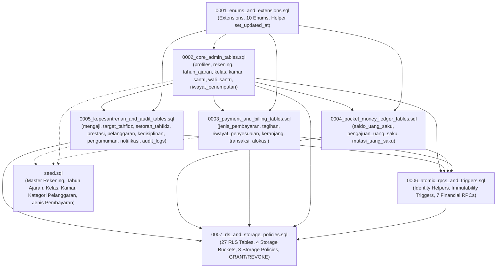

# PETA DEPENDENSI MIGRASI DATABASE SIPETA
**Pondok Pesantren Modern Abu Manshur**  
**Versi Skema**: 1.0.0 (PostgreSQL 16 / Supabase)  
**Tanggal Audit**: 8 November 2026  
**Status**: Terverifikasi Bebas Siklus (Directed Acyclic Graph / DAG Valid)

---

## 1. Ikhtisar Alur Dependensi Migrasi

Migrasi SQL SIPETA terdiri dari 7 berkas berurutan (`0001` s.d. `0007`) ditambah `seed.sql`. Struktur relasi antarmigrasi membentuk graf terarah tanpa siklus (*Directed Acyclic Graph* / DAG) sebagai berikut:

---

## 2. Inventarisasi dan Rincian Objek per Berkas Migrasi

| No | Nama Berkas | Enums | Tabel | Indeks | Foreign Keys | Triggers | Functions / RPCs | RLS Policies |
| :---: | :--- | :---: | :---: | :---: | :---: | :---: | :---: | :---: |
| **0001** | `0001_enums_and_extensions.sql` | 10 | 0 | 0 | 0 | 0 | 1 | 0 |
| **0002** | `0002_core_admin_tables.sql` | 0 | 8 | 6 | 13 | 4 | 0 | 0 |
| **0003** | `0003_payment_and_billing_tables.sql` | 0 | 6 | 5 | 11 | 3 | 0 | 0 |
| **0004** | `0004_pocket_money_ledger_tables.sql` | 0 | 3 | 3 | 5 | 1 | 0 | 0 |
| **0005** | `0005_kepesantrenan_and_audit_tables.sql` | 0 | 10 | 7 | 15 | 0 | 0 | 0 |
| **0006** | `0006_atomic_rpcs_and_triggers.sql` | 0 | 0 | 0 | 0 | 6 | 15 | 0 |
| **0007** | `0007_rls_and_storage_policies.sql` | 0 | 0 | 0 | 0 | 0 | 0 | 51 (43 Tabel + 8 Storage) |
| **SEED** | `seed.sql` | 0 | (Data) | 0 | 0 | 0 | 0 | 0 |
| **TOTAL**| **8 Berkas** | **10** | **27** | **21** | **44** | **14** | **16** | **51** |

---

## 3. Matriks Ketergantungan Foreign Key Antar-Tabel

Semua 27 tabel operasional diurutkan berdasarkan tingkat dependensi hierarkis (Level 0 = tidak memiliki FK, Level 4 = tabel transaksi paling bergantung):

| Level | Tabel | Kolom PK | Tabel Induk yang Dirujuk (Foreign Key) | Kebijakan ON DELETE |
| :--- | :--- | :--- | :--- | :--- |
| **L0** | `auth.users` *(Supabase core)* | `id` | - | - |
| **L0** | `tahun_ajaran` | `id` | - | - |
| **L0** | `kelas` | `id` | - | - |
| **L0** | `kamar` | `id` | - | - |
| **L0** | `master_kategori_pelanggaran` | `id` | - | - |
| **L1** | `profiles` | `id` | `auth.users(id)` | `CASCADE` |
| **L1** | `target_tahfidz` | `id` | `tahun_ajaran(id)`, `kelas(id)` | `RESTRICT` |
| **L1** | `pengumuman` | `id` | `profiles(id)` | `RESTRICT` |
| **L1** | `audit_logs` | `id` | `profiles(id)` | `SET NULL` |
| **L2** | `rekening_pesantren` | `id` | `profiles(id)` (updated_by) | `SET NULL` |
| **L2** | `santri` | `id` | `tahun_ajaran(id)`, `kelas(id)`, `kamar(id)` | `RESTRICT` |
| **L2** | `jenis_pembayaran` | `id` | `tahun_ajaran(id)`, `profiles(id)` | `RESTRICT` |
| **L3** | `wali_santri` | `id` | `profiles(id)`, `santri(id)` | `RESTRICT` (1:1) |
| **L3** | `riwayat_penempatan_santri` | `id` | `santri(id)`, `kelas(id)`, `kamar(id)`, `profiles(id)` | `CASCADE` (santri), `RESTRICT` (kelas/kamar) |
| **L3** | `tagihan` | `id` | `santri(id)`, `jenis_pembayaran(id)`, `profiles(id)` | `RESTRICT` |
| **L3** | `saldo_uang_saku` | `santri_id` | `santri(id)` | `RESTRICT` |
| **L3** | `pengajuan_uang_saku` | `id` | `santri(id)`, `profiles(id)` (wali & verifikator) | `RESTRICT` |
| **L3** | `perkembangan_mengaji` | `id` | `santri(id)`, `profiles(id)` | `RESTRICT` |
| **L3** | `setoran_tahfidz` | `id` | `santri(id)`, `profiles(id)` | `RESTRICT` |
| **L3** | `prestasi_santri` | `id` | `santri(id)`, `profiles(id)` | `RESTRICT` |
| **L3** | `catatan_kedisiplinan` | `id` | `santri(id)`, `master_kategori_pelanggaran(id)`, `profiles(id)` | `RESTRICT` |
| **L3** | `notifikasi` | `id` | `profiles(id)`, `santri(id)` | `CASCADE` |
| **L4** | `riwayat_penyesuaian_tagihan` | `id` | `tagihan(id)`, `profiles(id)` | `RESTRICT` |
| **L4** | `keranjang_pembayaran` | `id` | `profiles(id)`, `santri(id)`, `tagihan(id)` | `CASCADE` |
| **L4** | `transaksi_pembayaran` | `id` | `santri(id)`, `profiles(id)` (wali & bendahara) | `RESTRICT` |
| **L4** | `mutasi_uang_saku` | `id` | `santri(id)`, `pengajuan_uang_saku(id)`, `mutasi_uang_saku(id)` (self), `profiles(id)` | `RESTRICT` |
| **L4** | `riwayat_perubahan_kedisiplinan`| `id` | `catatan_kedisiplinan(id)`, `profiles(id)` | `RESTRICT` |
| **L5** | `alokasi_pembayaran` | `id` | `transaksi_pembayaran(id)`, `tagihan(id)` | `CASCADE` (transaksi), `RESTRICT` (tagihan) |

---

## 4. Analisis Potensi Masalah Dependensi

1. **Circular Dependency (Ketergantungan Melingkar)**:
   - **Hasil Pemeriksaan**: `TIDAK DITEMUKAN`. Seluruh foreign key mengalir dari tabel hilir ke tabel hulu.
   - Tabel `mutasi_uang_saku` memiliki referensi mandiri (`referensi_mutasi_id REFERENCES mutasi_uang_saku(id)`) untuk pencatatan koreksi/jurnal pembalik, yang sah dan bertipe nullable (`RESTRICT`).

2. **Orphan Record Risk (Risiko Data Yatim)**:
   - Data keuangan inti (`transaksi_pembayaran`, `alokasi_pembayaran`, `mutasi_uang_saku`, `tagihan`, `saldo_uang_saku`) dilindungi dengan `ON DELETE RESTRICT`. Santri atau tagihan yang memiliki riwayat keuangan tidak dapat dihapus sembarangan, mencegah integritas pembukuan terputus.
   - Penghapusan profil pengguna dibatasi oleh `ON DELETE RESTRICT` pada seluruh relasi operasional, kecuali tabel anak yang bersifat sementara seperti `keranjang_pembayaran` dan `notifikasi` (`CASCADE`).

3. **Urutan Eksekusi Wajib**:
   - Berkas migrasi **WAJIB** dieksekusi secara berurutan sesuai nomor prefiks `0001` s.d. `0007`.
   - `seed.sql` hanya boleh dieksekusi **SETELAH** seluruh migrasi `0001` s.d. `0007` selesai diterapkan.

