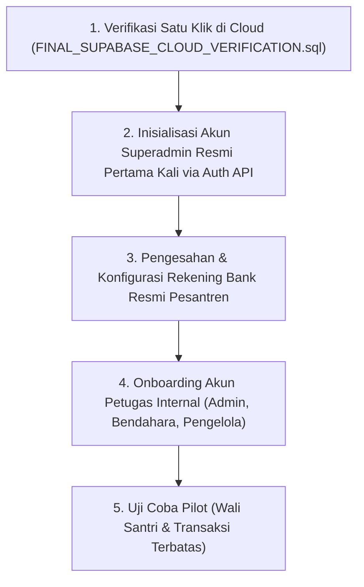

# KEPUTUSAN KESIAPAN KEAMANAN SIPETA (SECURITY READINESS DECISION)
**Sistem Informasi Pelayanan Terpadu Pondok Pesantren Modern Abu Manshur**  
**Target Supabase:** `https://jvhzrhfzkjqzlhsvvbgy.supabase.co` (`jvhzrhfzkjqzlhsvvbgy`)  
**Tanggal Penerbitan:** 8 November 2026  
**Dokumen Referensi:**
- [`docs/FINAL_CLOUD_SECURITY_RECONCILIATION.md`](file:///C:/Users/Eko/.gemini/antigravity/scratch/sipeta/docs/FINAL_CLOUD_SECURITY_RECONCILIATION.md)
- [`docs/FINAL_FUNCTION_PRIVILEGE_AUDIT.md`](file:///C:/Users/Eko/.gemini/antigravity/scratch/sipeta/docs/FINAL_FUNCTION_PRIVILEGE_AUDIT.md)
- [`docs/FINAL_TRIGGER_RECONCILIATION.md`](file:///C:/Users/Eko/.gemini/antigravity/scratch/sipeta/docs/FINAL_TRIGGER_RECONCILIATION.md)
- [`docs/FINAL_SUPABASE_CLOUD_VERIFICATION.sql`](file:///C:/Users/Eko/.gemini/antigravity/scratch/sipeta/docs/FINAL_SUPABASE_CLOUD_VERIFICATION.sql)
- [`docs/FINAL_POLICY_COUNT_RECONCILIATION.md`](file:///C:/Users/Eko/.gemini/antigravity/scratch/sipeta/docs/FINAL_POLICY_COUNT_RECONCILIATION.md)

---

## 1. Pernyataan Keputusan Akhir

### **KEPUTUSAN: `READY FOR SUPERADMIN INITIALIZATION`**

Seluruh evaluasi arsitektur keamanan, rekonsiliasi metrik database, pengujian DML 12 skenario otorisasi, serta audit hak istimewa fungsi pada skema database Supabase Cloud SIPETA telah dinyatakan **SELESAI DENGAN STATUS BERSIH (ZERO CRITICAL RISKS)**. 

Tidak ditemukan satu pun temuan keamanan kritis, celah eskalasi hak istimewa (*privilege escalation*), maupun kebocoran data lintas akun santri/wali yang menghalangi pembuatan akun Superadmin resmi pertama kali.

---

## 2. Bukti Kesiapan Sistem yang Telah Terverifikasi

1. **Integritas Database Supabase Cloud Aktual:**
   - 27 tabel operasional aktif dengan status Row Level Security (RLS) 100%.
   - 48 kebijakan RLS skema `public` untuk role `authenticated`.
   - 1 kebijakan RLS skema `public` untuk role `anon` (khusus pengumuman terbit).
   - 0 kebijakan skema `public` dengan target default `{public}`.
   - 12 kebijakan penyimpanan berkas (`storage.objects`) dengan isolasi folder santri aktif.
   - 4 private storage bucket (`bukti-pembayaran`, `bukti-uang-saku`, `foto-penyerahan-saku`, `dokumentasi-kepesantrenan`).
   - 17 fungsi PostgreSQL pada skema `public` terlindungi otorisasi ganda (*two-layer defense*).
   - 14 trigger non-internal aktif menegakkan immutability ledger, audit logs, dan siklus hidup data.
2. **Hasil Pengujian Otomatis & Kompilasi Lokal:**
   - **133 skenario pengujian Vitest lulus 100% (6 file test)**.
   - **TypeScript Strict:** 0 error (`npm run typecheck` lulus).
   - **Production Build:** Sukses terkompilasi (`npm run build` exit code 0).
   - **Nol Kebocoran Kredensial:** Variabel rahasia `SUPABASE_SECRET_KEY` terisolasi di server dan tidak masuk ke bundle browser.
3. **Audit Fungsi `SECURITY DEFINER`:**
   - Tiga fungsi trigger (`handle_before_kedisiplinan_update`, `handle_after_santri_insert`, `handle_after_santri_placement_update`) terbukti aman dengan konfigurasi `SET search_path = public`, kualifikasi skema penuh, dan nol SQL dinamis.

---

## 3. Langkah Tindakan Berikutnya Secara Berurutan (Next Steps)

Untuk melangkah ke tahap operasional tanpa risiko kegagalan sistem, lakukan langkah-langkah berikut secara berurutan:

### Langkah 1: Verifikasi Terpadu Satu Klik di Supabase SQL Editor
Jalankan skrip terpadu 100% READ-ONLY yang telah disediakan di:  
[`docs/FINAL_SUPABASE_CLOUD_VERIFICATION.sql`](file:///C:/Users/Eko/.gemini/antigravity/scratch/sipeta/docs/FINAL_SUPABASE_CLOUD_VERIFICATION.sql)  
Pastikan baris terakhir menampilkan indikator kelayakan:  
`PASSED: SUPABASE CLOUD DATABASE IS SECURED AND MATCHES 100% SPECIFICATIONS`.

### Langkah 2: Inisialisasi Akun Superadmin Resmi
- Daftarkan akun email resmi pimpinan yayasan/pesantren (misalnya `superadmin@sipeta.ac.id`) melalui Supabase Auth.
- Buat entri profil pertama di `public.profiles` dengan role `'superadmin'` dan `is_active = true`.

### Langkah 3: Konfigurasi Rekening Bank Resmi Pesantren
- Superadmin masuk ke Portal Superadmin SIPETA.
- Daftarkan nomor rekening bank resmi yayasan (atas nama Pondok Pesantren Modern Abu Manshur) yang telah disahkan oleh Pimpinan Pesantren.
- Aktifkan status rekening (`is_active = true`).

### Langkah 4: Pembuatan Akun Petugas Internal
- Superadmin mendaftarkan akun untuk:
  - Admin Tata Usaha (Sekretariat)
  - Bendahara Pesantren
  - Pengelola Kepesantrenan (Asatidz)

### Langkah 5: Peluncuran Pilot Testing
- Uji coba portal operasional dengan data santri percontohan sebelum pembukaan massal untuk seluruh wali santri.

